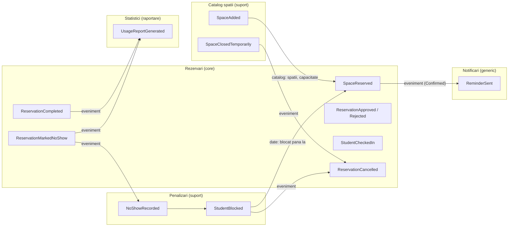

# Event Storming - Rezervarea spatiilor de studiu

Livrabilul Partii 1: evenimentele domeniului in ordine cronologica, grupate in bounded contexts, cu comenzile, agregatele, regulile si invariantii asociati.

Domeniul: studentii rezerva sali de studiu individuale, sali de grup si laboratoare din biblioteca si camin; bibliotecarul aproba rezervarile lungi si monitorizeaza utilizarea; un sistem automat trimite reminder-e, anuleaza rezervarile la care studentul nu vine si aplica penalizarile.

## 1. Evenimentele domeniului (Pas 1)

In ordinea in care apar in viata unei rezervari. Formatul cerut: `EventName | Trigger | Data | Subsequent Events`.

| # | Eveniment | Declansator | Date | Evenimente urmatoare |
|---|---|---|---|---|
| 1 | `SpaceAdded` | Bibliotecar | cod spatiu, tip (IND/GRP/LAB), capacitate, echipamente | - |
| 2 | `SpaceClosedTemporarily` | Bibliotecar | cod spatiu, interval, motiv | `ReservationCancelled` (pentru rezervarile din interval) |
| 3 | `SpaceReserved` | Student (`ReserveSpace`) | cod rezervare, student, spatiu, interval, persoane, stare (confirmata / asteapta aprobare) | `ReminderScheduled` (daca e confirmata) sau `ApprovalRequested` |
| 4 | `ApprovalRequested` | Sistem, la `SpaceReserved` lung sau pe laborator | cod rezervare, motiv | `ReservationApproved` / `ReservationRejected` |
| 5 | `ReservationApproved` | Bibliotecar | cod rezervare, aprobat de, cand | `ReminderScheduled` |
| 6 | `ReservationRejected` | Bibliotecar | cod rezervare, motiv | - (intervalul se elibereaza) |
| 7 | `ReminderScheduled` | Sistem | cod rezervare, ora reminder (start - 30 min) | `ReminderSent` |
| 8 | `ReminderSent` | Sistem (ceas) | cod rezervare, student, canal | - |
| 9 | `ReservationCancelled` | Student sau sistem | cod rezervare, cine, motiv, cu cat timp inainte | `LateCancellationRecorded` (daca e tarzie) |
| 10 | `StudentCheckedIn` | Student (scaneaza codul la usa) | cod rezervare, ora | `StudentCheckedOut` |
| 11 | `ReservationMarkedNoShow` | Sistem: > 15 min de la start fara check-in | cod rezervare, student, ora | `NoShowRecorded`; intervalul ramas se elibereaza |
| 12 | `StudentCheckedOut` / `ReservationCompleted` | Student sau sistem la final | cod rezervare, durata efectiva | `UsageRecorded` |
| 13 | `NoShowRecorded` | Penalizari, la `ReservationMarkedNoShow` | student, data | `StudentBlocked` (la al 3-lea in 30 de zile) |
| 14 | `StudentBlocked` | Penalizari | student, blocat pana la (+7 zile) | `ReservationCancelled` (rezervarile viitoare ale studentului) |
| 15 | `StudentUnblocked` | Sistem (ceas) | student | - |
| 16 | `UsageReportGenerated` | Bibliotecar / sistem lunar | perioada, grad de ocupare per spatiu, rata de neprezentare | - |

Observatii din discutie:

- **Cautarea spatiilor libere** (filtru capacitate, echipament, interval) este o **interogare**, nu un eveniment: nu schimba nimic. Apare ca model de citire in contextul Rezervari.
- **Nu exista evenimente de esec** (`ReservationFailed`): o cerere respinsa nu s-a intamplat in domeniu; studentul primeste erorile si nimic nu se publica.
- **`SpaceReserved` are doua variante de stare**, nu doua evenimente: consumatorii (notificari, coada de aprobare) reactioneaza la acelasi fapt in functie de `Status`.

## 2. Bounded contexts (Pas 2)

| Context | Evenimente | Responsabilitati | Comunicare |
|---|---|---|---|
| **Catalog spatii** (suport) | `SpaceAdded`, `SpaceClosedTemporarily` | Ce spatii exista, tip, capacitate, echipamente, program | Rezervari citesc catalogul (model de citire); `SpaceClosedTemporarily` -> Rezervari anuleaza |
| **Rezervari** (core) | `SpaceReserved`, `ApprovalRequested`, `ReservationApproved/Rejected`, `ReservationCancelled`, `StudentCheckedIn`, `ReservationMarkedNoShow`, `ReservationCompleted` | Regulile de rezervare: interval valid, capacitate, fara suprapuneri, limite zilnice, aprobare, check-in, neprezentare | Publica evenimente catre Notificari, Penalizari, Statistici; primeste de la Penalizari lista studentilor blocati |
| **Penalizari** (suport) | `NoShowRecorded`, `LateCancellationRecorded`, `StudentBlocked`, `StudentUnblocked` | Numara neprezentarile, aplica blocarea de o saptamana | Asculta `ReservationMarkedNoShow`; expune „blocat pana la”; publica `StudentBlocked` |
| **Notificari** (generic) | `ReminderScheduled`, `ReminderSent` | Reminder cu 30 min inainte, mesaje de aprobare/respingere | Asculta `SpaceReserved` (Confirmed), `ReservationApproved` |
| **Statistici** (raportare) | `UsageRecorded`, `UsageReportGenerated` | Grad de ocupare, ore de varf, rata de neprezentare | Asculta evenimentele de final de rezervare; doar citire |

## 3. Comenzi, agregate, reguli si invarianti (Pas 3)

### Rezervari (contextul implementat)

| Comanda | Eveniment | Agregat | Reguli de validare |
|---|---|---|---|
| `ReserveSpace` | `SpaceReserved` | `Reservation` (verificata fata de programul spatiului) | matricol `LM12345`; cod spatiu `LIB-2-IND-05`; spatiul exista; interval 08:00-22:00, la fix sau la jumatate, 30 min - 4 h; in viitor; studentul nu e blocat; persoane 1-30, <= capacitate; individual = 1 persoana, grup >= 2; spatiul liber; studentul nu are alta rezervare suprapusa; max 2 h/zi individual, max 4 h/zi grup/laborator |
| `ApproveReservation` | `ReservationApproved` | `Reservation` | rezervarea asteapta aprobare; intervalul nu a inceput |
| `RejectReservation` | `ReservationRejected` | `Reservation` | rezervarea asteapta aprobare; motiv obligatoriu |
| `CancelReservation` | `ReservationCancelled` | `Reservation` | rezervarea e confirmata sau asteapta aprobare; doar studentul ei sau sistemul |
| `CheckIn` | `StudentCheckedIn` | `Reservation` | rezervarea confirmata; intre start - 10 min si start + 15 min |
| `MarkNoShow` (automat) | `ReservationMarkedNoShow` | `Reservation` | confirmata, fara check-in, > 15 min de la start |

Invarianti ai agregatului:

- **Doua rezervari ale aceluiasi spatiu nu se suprapun.** Consistenta este pe „programul zilei” spatiului; in implementare se verifica fata de rezervarile existente incarcate inainte (`ExistingReservation`), iar o baza reala ar avea nevoie si de o constrangere la salvare (ca stocul din Lab 5).
- O rezervare confirmata are un reminder; una in asteptare are un motiv - niciodata amandoua (`ReservationApproval`, tip-suma).
- O rezervare marcata ca neprezentare nu mai poate primi check-in.

### Penalizari

| Comanda | Eveniment | Agregat | Reguli |
|---|---|---|---|
| `RecordNoShow` | `NoShowRecorded` | `StudentStanding` | o singura inregistrare per rezervare (idempotent) |
| `BlockStudent` (automat) | `StudentBlocked` | `StudentStanding` | 3 neprezentari in 30 de zile -> blocat 7 zile de la ultima |

Invariant: un student blocat nu poate avea rezervari noi pana la expirarea blocarii (aplicat de Rezervari prin datele primite).

### Catalog spatii

| Comanda | Eveniment | Agregat | Reguli |
|---|---|---|---|
| `AddSpace` | `SpaceAdded` | `StudySpace` | cod unic si bine format; capacitate 1-30; un spatiu individual are capacitate 1 |
| `CloseSpaceTemporarily` | `SpaceClosedTemporarily` | `StudySpace` | interval valid; motiv |

## 4. Ce s-a implementat

Workflow-ul `ReserveSpace` din contextul Rezervari, complet (Partile 2-4), plus regulile pure ale Penalizarilor de care depinde (`NoShowPolicy`: neprezentare dupa 15 minute, blocare dupa 3 neprezentari). Celelalte comenzi si contexte sunt descrise aici ca rezultat al analizei, nu implementate.
